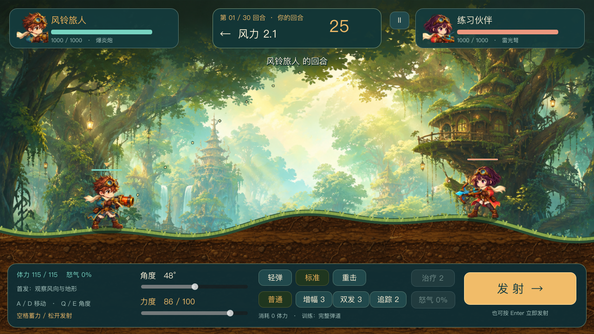
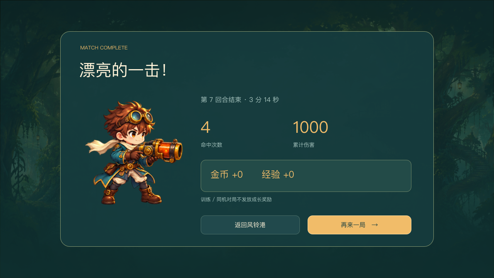

# How Star Arc Battle keeps an artillery shot honest

An artillery game feels wrong when the preview arc, projectile, and ground collision disagree. Star Arc Battle keeps them on one simulation path. The aim trace and shot share the same movement and collision rules.

That simulation advances in 1/120-second steps. That is the physics time step, not display FPS. Each step applies gravity and wind, then checks 3-pixel samples. The terrain is an 8-pixel height field, so the collision check samples space between frames and can catch a ridge.

A hit applies direct or splash damage and carves a crater into the terrain. The changed ground remains for later turns, so the player chooses another angle or power. The turn settles before wind changes.

The v0.5.2 validation archive shows a forest battle HUD with wind, angle, power, movement, and firing controls, followed by a result screen marked complete on round 7. I did not rerun this snapshot locally; the captures document its archived state.

Open `project.godot` in Godot 4.6 or newer, run it, use A/D to move, Q/E to aim, and hold then release Space to charge and fire. The repository has no macOS bundle, and its `LICENSE.md` requires permission to reuse code or generated assets. A fresh export and target-machine verification would be the next useful check. Source: https://github.com/Angelov1314/star-arc-battle

